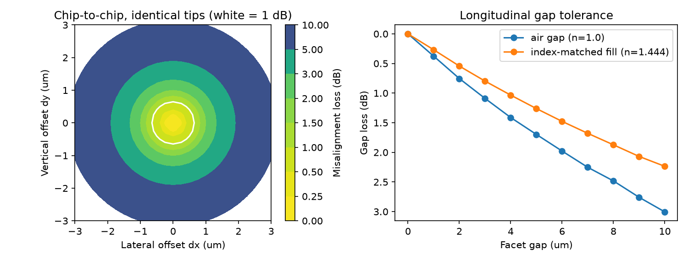

# SiN edge-coupler study: from mode design to assembly yield

[](https://github.com/deeppunj/sipho-coupler-study/actions/workflows/tests.yml)



A small, self-contained Python study of a **SiN inverse-taper edge coupler** for fibre-to-chip and
chip-to-chip (optical interposer / flip-chip) coupling at 1550 nm. It runs the chain from design to
packaging: **mode design → coupling to fibre → misalignment and gap tolerance → assembly yield → process window → test-chip DOE layout.**

Written as a quick, transparent starting point. It does not replace RSoft, Lumerical or PhotonDesign.

## What it does

| Step | Script | Output |
|---|---|---|
| FD mode solver (scalar), checked against the exact slab solution (error 2e-5 in n_eff) | `modesolver.py` | console |
| Tip-width sweep: n_eff, mode-field diameter, coupling to SMF-28 and UHNA7 | `coupler_study.py` | `figures/1_tip_sweep.png` |
| Chip-to-chip misalignment map and gap loss (air vs index-matched fill, angular-spectrum propagation) | `coupler_study.py` | `figures/3_chip_to_chip_tolerance.png` |
| Monte Carlo assembly yield vs bonder placement accuracy | `coupler_study.py` | `figures/4_assembly_yield.png` |
| Gaussian-process surrogate over (tip width, SiN thickness) + process-variation Monte Carlo | `coupler_study.py` | `figures/5_process_window.png` |
| Test-chip DOE: tip sweep, taper-length sweep, designed lateral offsets, 127 µm pitch | `layout_doe.py` | `layout/doe_chip.gds`, preview, table |
| Expanded-beam micro-optic relay (SMF-28 → chip): Gaussian mode matching + **Optiland** real-ray check of spherical vs conic lens | `microoptic_coupling.py` | `figures/6_…`, `figures/7_optiland_relay_layout.png` |

## Key results (SiN 300 nm, n = 1.98, SiO2 cladding, TE, 1550 nm)

- **Tip width controls mode size:** about 4 µm MFD at a 250 nm tip, and 8.6 µm at 150 nm.
- **Fibre coupling:** best match to UHNA7 is **0.43 dB at a 250 nm tip**. SMF-28 needs a tip of ≤150 nm (0.37 dB in this model, but that is optimistic near cut-off).
- **Chip-to-chip (250 nm tips facing):** the 1 dB misalignment radius is about 0.7 µm. Gap loss at 5 µm is 1.7 dB in air and 1.25 dB with an index-matched fill.
- **Assembly yield at a 1 dB spec:** 96 % at σ = 0.25 µm, 56 % at σ = 0.5 µm and 19 % at σ = 1 µm.
  → Passive flip-chip placement at ±1 µm is not enough for small modes. You need either **mode expansion** (smaller tip or a multi-layer taper), **self-alignment** (stops, solder reflow) or **active alignment**.
- **Process window:** with tip σ = 15 nm and thickness σ = 3 %, UHNA7 loss is 0.48 dB on average and 0.67 dB at P95. The GP surrogate (built from 18 solver runs) has a leave-one-out RMSE of 0.007 dB.
- **Note:** the misalignment loss is about 2× what a Gaussian with the same second-moment MFD would predict. The real mode has a sharp peak and wide tails, so a Gaussian fit overstates the tolerance.

## Micro-optic option (Optiland)

Butt coupling is limited by sub-µm alignment. A two-lens expanded-beam relay matches the SMF-28 mode (10.4 µm) to the chip mode (≈4 µm, m = 0.38, f1 = 1 mm, f2 = 0.38 mm). At the mating interface, the 1 dB lateral tolerance grows from about **1 µm to 46 µm**. The price is a tight angular tolerance of **2.5 mrad**. Optiland traces real rays through the relay. The paraxial magnification is −0.383, which matches the target. At the chip-side NA of about 0.25, a **spherical** focusing lens gives a **21.7 µm RMS spot**, far larger than the 2 µm chip mode. A **conic** surface (k = −1/n²) brings it to **2.9 µm**, 7× better. Expanded-beam coupling at this NA therefore needs aspheric or GRIN micro-optics. Caveat: the RMS spot weights all rays equally, out to 1.5× the 1/e² cone, so it overstates the effect of the edge rays. The proper single-mode measure is the Gaussian-weighted wavefront error converted into a coupling loss. That is the next step.

## Limitations

- Scalar mode solver, with no polarisation or full-vector effects and no Fresnel reflection. Values near cut-off (tips under 170 nm) are window-limited.
- No substrate leakage, taper transition loss or facet roughness are modelled. A next step is EME/FDTD in Lumerical, femwell or Tidy3D.
- The process-variation numbers are illustrative assumptions, not imec data.

## Run

Python 3.10 or newer.

```bash
python -m venv .venv && source .venv/bin/activate     # Windows: .venv\Scripts\activate
pip install -r requirements.txt
pytest -v                       # physics checks against analytic results, ~10 s
python modesolver.py            # slab validation
python coupler_study.py         # ~6 min on a laptop
python layout_doe.py            # GDS + preview
python microoptic_coupling.py   # expanded-beam relay, Optiland ray trace
```

The tests compare the code with known results: the exact slab mode, Gaussian overlap under offset and size mismatch, power conservation and Gaussian gap loss in propagation, and a 32-row DOE. GitHub Actions runs them, plus the layout and Optiland scripts, on Python 3.10 and 3.12 at every push.

## Next steps

Full-vector check in femwell or Lumerical MODE, an EME taper-length sweep, polarisation dependence, a SiN/Si
bilayer transition, port to gdsfactory or IPKISS PCells, then fabricate and measure the DOE to calibrate the tolerance model.

## License

MIT, see `LICENSE`.
